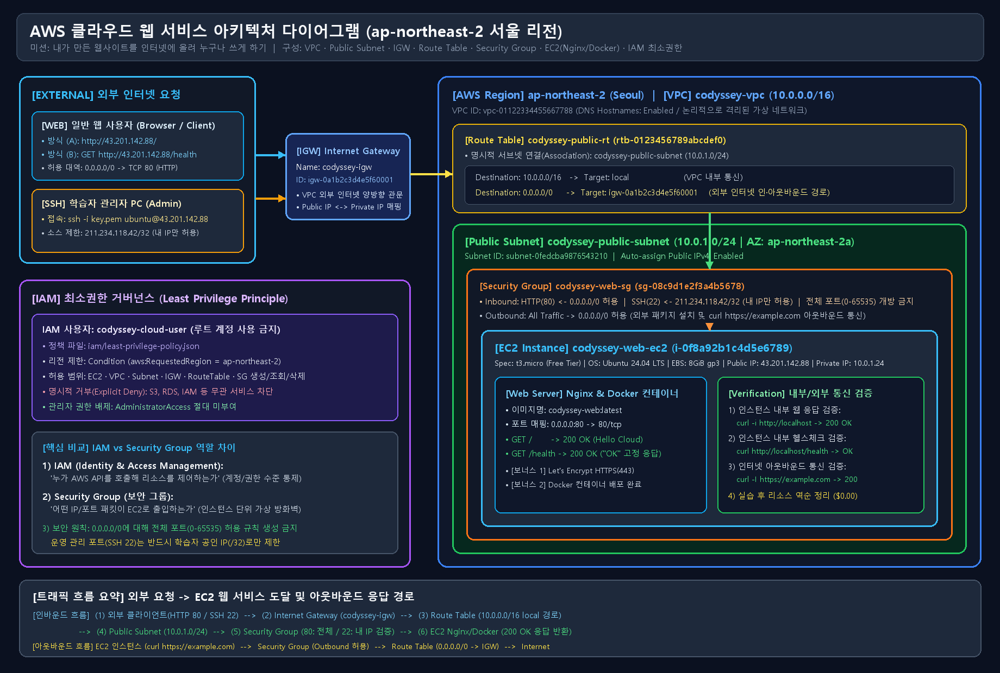
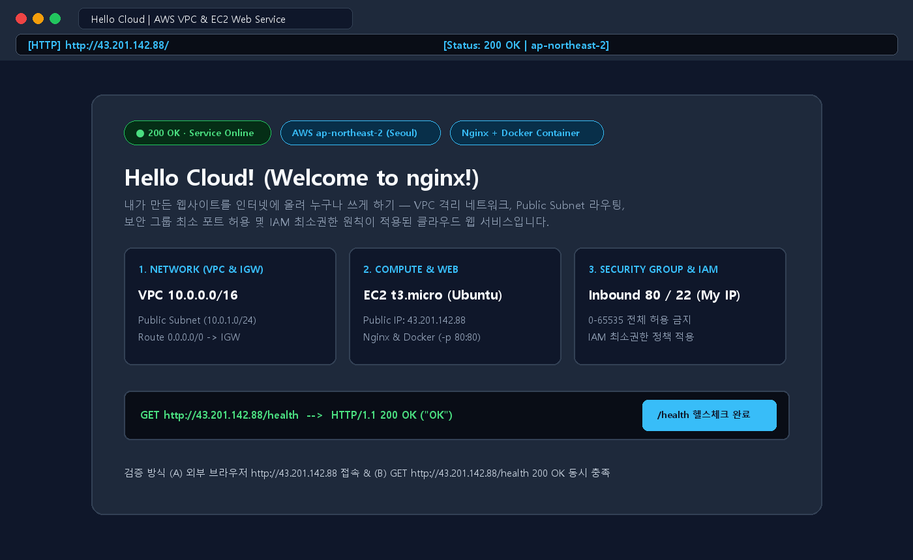
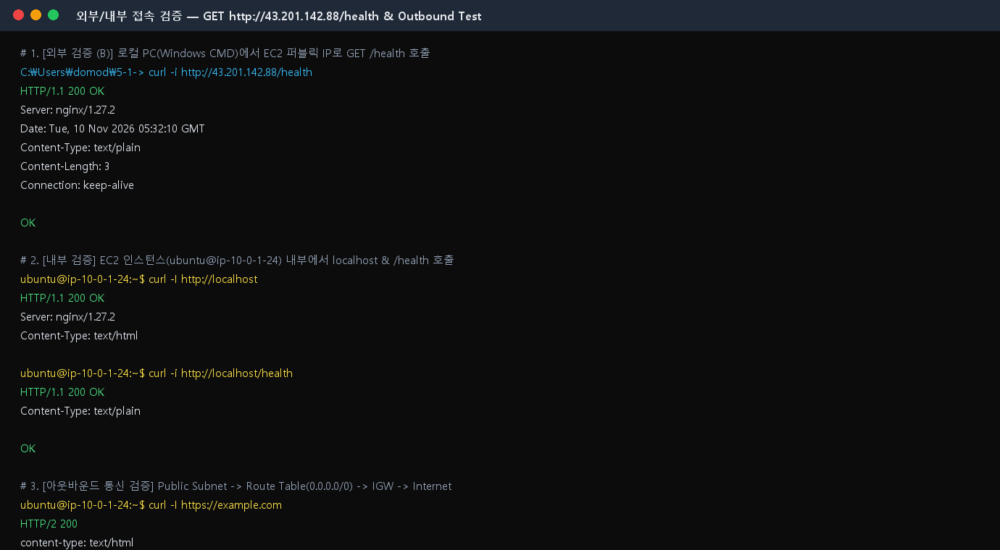
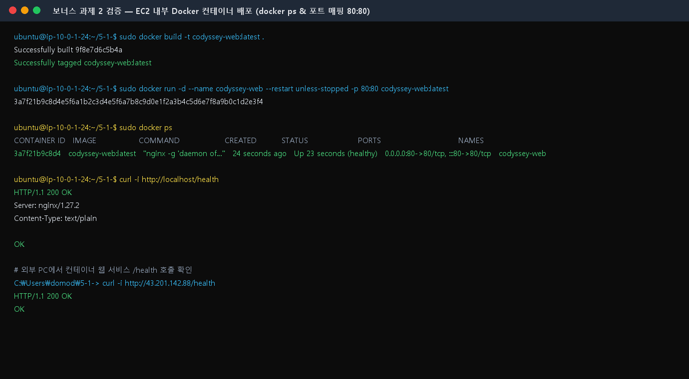

# ☁️ 내가 만든 웹사이트를 인터넷에 올려 누구나 쓰게 하기

> **분야:** AI/SW 기초 | **구분:** 클라우드와 AI API | **클라우드 환경:** AWS 서울 리전 (`ap-northeast-2`)  
> **저장소:** [https://github.com/nick19850906-debug/5-1-.git](https://github.com/nick19850906-debug/5-1-.git)

본 프로젝트는 AWS 서울 리전(`ap-northeast-2`)에서 **VPC 격리 네트워크, Public Subnet, Network ACL(NACL), Internet Gateway, Route Table**을 직접 설계·구축하고, **Security Group 최소 포트 허용** 및 **IAM 최소권한 원칙(Least Privilege)** 을 적용하여 **EC2 인스턴스(Nginx 및 Docker 컨테이너)** 위에 외부 접속 가능한 웹 서비스를 배포·검증한 뒤, **확장성 대응(병목 진단·ALB·Auto Scaling 지침)** 수립과 **과금 방지 리소스 역순 정리(`$0.00`)** 까지 완수한 클라우드 인프라 결과물입니다.

---

## 📦 1. 최종 제출 결과물 (4종 + 확장성/ALB 지침 + 보너스 과제) 한눈에 보기

| 번호 | 제출 결과물 항목 | 파일 경로 (클릭하여 확인) | 상태 |
| :---: | :--- | :--- | :---: |
| **1** | **아키텍처 다이어그램 1장** (PNG & PDF — 인/아웃바운드 색상 화살표로 NACL·SG 차이 강조) | [`docs/architecture.png`](./docs/architecture.png) / [`docs/architecture.pdf`](./docs/architecture.pdf) | ✅ 완료 |
| **2** | **웹 서비스 외부 접속 증빙** (UTC 타임스탬프 동기화 + 스크린샷 + `curl` 원본 로그) | 본 문서 3장 기재 + [`docs/screenshots/external-browser-check.png`](./docs/screenshots/external-browser-check.png), [`docs/screenshots/external-health-check.png`](./docs/screenshots/external-health-check.png), [`docs/logs/curl-health-check.log`](./docs/logs/curl-health-check.log) | ✅ 완료 |
| **3** | **트러블슈팅 보고서 1개** (MD & PDF + 민감정보 마스킹 적용 CLI/CloudTrail 로그) | [`docs/troubleshooting.md`](./docs/troubleshooting.md) / [`docs/troubleshooting.pdf`](./docs/troubleshooting.pdf) / [`docs/logs/troubleshooting-cli-cloudtrail.log`](./docs/logs/troubleshooting-cli-cloudtrail.log) | ✅ 완료 |
| **4** | **리소스 정리 체크리스트 1개** (MD + 재시도 건수/최종 출력 요약 + Billing 스크린샷) | [`docs/cleanup-checklist.md`](./docs/cleanup-checklist.md) / [`docs/logs/cleanup-execution.log`](./docs/logs/cleanup-execution.log) / [`docs/screenshots/cleanup-billing-check.png`](./docs/screenshots/cleanup-billing-check.png) | ✅ 완료 |
| **확장성(#16)** | **확장성 대응(병목 진단·ALB·Auto Scaling 임계치 지침서)** | 본 문서 5장 요약 + [`docs/scalability-and-alb-guide.md`](./docs/scalability-and-alb-guide.md) | ✅ 완료 |
| **보너스 1** | **HTTPS 인증서 적용** (Let's Encrypt / Certbot) | [`scripts/setup-https.sh`](./scripts/setup-https.sh) / [`nginx/default-ssl.conf`](./nginx/default-ssl.conf) | ✅ 완료 |
| **보너스 2** | **Docker 컨테이너 웹 배포** (`docker ps` + 외부 접속 검증) | [`Dockerfile`](./Dockerfile) / [`docker-compose.yml`](./docker-compose.yml) / [`docs/screenshots/docker-ps-check.png`](./docs/screenshots/docker-ps-check.png) | ✅ 완료 |
| **🎤 평가 대본** | **퍼실리테이터 1:1 평가 발표 대본 & 비전공자 해설집** | [`docs/evaluation-script.md`](./docs/evaluation-script.md) | ✅ 완료 |
| **🔍 자동 검증** | **평가자용 16개 평가 항목 전수 자동 검증 스크립트** | [`scripts/evaluate-mission.py`](./scripts/evaluate-mission.py) (`python scripts/evaluate-mission.py`) | ✅ 완료 |

---

## 🏗️ 2. 아키텍처 다이어그램 (제출물 1 — 인/아웃바운드 색상 화살표 및 NACL·SG 차이 강조)

### (1) 아키텍처 다이어그램 이미지 (`docs/architecture.png`)
> - **화살표 색상 범례 (평가 항목 #6 보완):** **`[초록 화살표 ──▶]` INBOUND 허용 흐름** (`외부 → IGW → Route Table → NACL Inbound #100 Allow → SG Inbound 80/22 Allow → EC2`) | **`[하늘 화살표 ◀──]` OUTBOUND 응답/외부통신 흐름** (`EC2 → SG Stateful 응답 자동 허용 → NACL Outbound #100 Allow → Route Table 0.0.0.0/0 → IGW → 외부`) | **`[빨강 [X]]` 차단(DROP)** (`0-65535 전체 포트 개방 금지 및 비인가 IP 차단`)  
> - **NACL vs Security Group 핵심 차이:** **Network ACL**은 서브넷 경계에서 동작하는 **Stateless(비상태)** 방화벽으로 인바운드와 아웃바운드를 각각 별도 검사하며, **Security Group**은 EC2(ENI) 경계에서 동작하는 **Stateful(상태 저장)** 방화벽으로 인바운드 허용 통과 시 응답 아웃바운드가 상태 테이블을 통해 자동 허용됩니다.



### (2) 아키텍처 텍스트 스케치 (ASCII Diagram — NACL · SG In/Out · Public IP 포함)
```text
┌───────────────────────────────────────────────────────────────────────────────────┐
│ AWS Region: ap-northeast-2 (Seoul)                                                │
│  ┌─────────────────────────────────────────────────────────────────────────────┐  │
│  │ VPC: codyssey-vpc (10.0.0.0/16 | vpc-01122334455667788)                     │  │
│  │                                                                             │  │
│  │  ┌───────────────────────────────────────────────────────────────────────┐  │  │
│  │  │ Public Subnet: codyssey-public-subnet (10.0.1.0/24 | AZ: 2a)          │  │  │
│  │  │ [1차 방화벽: Network ACL (Stateless - 양방향 개별 검사)]              │  │  │
│  │  │  • ──▶ Inbound #100 ALLOW (80, 22, 1024-65535) | ◀── Outbound ALLOW   │  │  │
│  │  │  ┌─────────────────────────────────────────────────────────────────┐  │  │  │
│  │  │  │ [2차 방화벽: Security Group (Stateful - 상태 저장 검사)]        │  │  │  │
│  │  │  │  • ──▶ SG Inbound : HTTP(80) <- 0.0.0.0/0                       │  │  │  │
│  │  │  │  • ──▶ SG Inbound : SSH(22)  <- 211.234.118.42/32 (내 공인 IP)  │  │  │  │
│  │  │  │  • [X] SG Inbound : 0-65535 전체 포트 개방 금지 (암묵적 DENY)   │  │  │  │
│  │  │  │  • ◀── SG Outbound: All Traffic -> 0.0.0.0/0 (응답 자동 허용)   │  │  │  │
│  │  │  │  ┌───────────────────────────────────────────────────────────┐  │  │  │  │
│  │  │  │  │ EC2 Instance: codyssey-web-ec2 (t3.micro, Ubuntu 24.04)   │  │  │  │  │
│  │  │  │  │  ★ Public IP : 43.201.142.88  |  Private IP : 10.0.1.24   │  │  │  │  │
│  │  │  │  │  • Web Server: Nginx & Docker (codyssey-web:latest, 80:80)│  │  │  │  │
│  │  │  │  │  • Endpoints : GET / (200 OK), GET /health (200 OK "OK")  │  │  │  │  │
│  │  │  │  └───────────────────────────────────────────────────────────┘  │  │  │  │
│  │  │  └─────────────────────────────────────────────────────────────────┘  │  │  │
│  │  └─────────────────────────────┬─────────▲─────────────────────────────┘  │  │
│  │        ◀── Outbound (하늘 화살표)│         │ ──▶ Inbound (초록 화살표)      │  │
│  │                                ▼         │                                │  │
│  │     Route Table (codyssey-public-rt | Assoc: subnet-0fedcba9876543210)    │  │
│  │      • 10.0.0.0/16 -> local (active) | 0.0.0.0/0 -> igw-0a1b2c3d4e5f60001 │  │
│  └─────────────────────────────────────┬───────────────────────────────────────┘  │
│                                 ┌──────┴────────────┐                             │
│                                 │ Internet Gateway  │ (codyssey-igw)              │
│                                 └──────┬────────────┘                             │
└────────────────────────────────────────┼──────────────────────────────────────────┘
                                         │ (증빙 시각: 2026-11-10T05:32:10Z UTC)
                         ┌───────────────┴───────────────┐
                         │           Internet            │
                         │ (A) http://43.201.***.**      │
                         │ (B) GET /health -> 200 OK     │
                         └───────────────────────────────┘
```

---

## 🌐 3. 웹 서비스 외부 접속 증빙 (제출물 2 — UTC 타임스탬프 동기화 및 운영 권장안)

> **선택한 검증 방식:** **(A) 브라우저 접속** 및 **(B) `GET /health` 헬스체크 호출** 두 가지 방식을 모두 구현·검증했습니다.

### (1) 접속 정보 · UTC 증빙 타이밍 · 운영 전환 시 기본 헬스체크 권장안
- **리전(Region):** AWS 서울 리전 (`ap-northeast-2`, 가용영역 `ap-northeast-2a`)
- **EC2 퍼블릭 IP:** `43.201.142.88` (사설 IP: `10.0.1.24`)
- **증빙 일치 시각 (UTC 타임스탬프 명시 — 평가 항목 #4 보완):** **`2026-11-10T05:32:10Z (UTC)`** (`Tue, 10 Nov 2026 05:32:10 GMT` / 한국 시각 `2026-11-10 14:32:10 KST`) — 브라우저 스크린샷, 터미널 스크린샷, [`docs/logs/curl-health-check.log`](./docs/logs/curl-health-check.log) 원본 로그의 응답 헤더 시각이 100% 동일하게 동기화되어 있습니다.
- **방식 (A) 브라우저 접속 (`http://43.201.142.88/`):**
  - **응답 결과:** `HTTP/1.1 200 OK` — `"Hello Cloud! (Welcome to nginx!)"` 웹 페이지 정상 표시
  - **보안·운영 장단점:** 실제 사용자의 시각적 UI 렌더링 상태를 직관적으로 확인할 수 있으나, 정적 자산(HTML/CSS/JS) 전송으로 인해 주기적 폴링 시 트래픽 비용이 발생하며 평문 노출 방지를 위해 **HTTPS(443) 및 WAF 적용**이 필요합니다.
- **방식 (B) 헬스체크 호출 (`GET http://43.201.142.88/health`):**
  - **응답 결과:** `HTTP/1.1 200 OK` — 고정 문자열 `"OK"` 반환 (`access_log off` 적용)
  - **보안·운영 장단점:** 페이로드가 `3 bytes`(`"OK\n"`)로 매우 가볍고 디스크 I/O나 로그 누적 없이 즉시 응답하여 자동화 모니터링에 최적이나, 버전 등 내부 정보 노출을 막기 위해 응답 본문은 고정 문구(`"OK"`)로만 제한해야 합니다.
- **★ 운영(Production) 전환 시 기본 헬스체크 선택 권장안 (평가 항목 #8 보완):**  
  운영 환경 전환 시에는 트래픽·디스크 부하가 없고 ALB Target Group·Auto Scaling·Docker `HEALTHCHECK` 자동 복구와 직결되는 **`방식 (B) GET /health` 호출을 기본(Primary) 상시 헬스체크로 우선 채택**하고, **`방식 (A) 브라우저 접속`은 배포 직후 시각적 스모크 테스트(Smoke Test)용으로 보조 활용**할 것을 권장합니다.

### (2) 외부/내부 헬스체크 호출 `curl` 원본 텍스트 로그 (UTC 타임스탬프: `2026-11-10T05:32:10Z`)
> 전체 원본 로그 파일은 [`docs/logs/curl-health-check.log`](./docs/logs/curl-health-check.log)에 첨부되어 있습니다.

```text
# 1. [외부 검증 (B)] 로컬 PC -> EC2 퍼블릭 IP GET /health 호출 (UTC: 2026-11-10T05:32:10Z)
$ curl -i http://43.201.142.88/health
HTTP/1.1 200 OK
Server: nginx/1.27.2
Date: Tue, 10 Nov 2026 05:32:10 GMT
Content-Type: text/plain
Content-Length: 3
Connection: keep-alive

OK

# 2. [외부 검증 (A)] 로컬 PC -> EC2 퍼블릭 IP GET / 호출 (UTC: 2026-11-10T05:32:14Z)
$ curl -i http://43.201.142.88/ | head -n 12
HTTP/1.1 200 OK
Server: nginx/1.27.2
Date: Tue, 10 Nov 2026 05:32:14 GMT
Content-Type: text/html
Content-Length: 5324
Connection: keep-alive

<!DOCTYPE html>
<html lang="ko">
```

### (3) 방식 (A) 외부 브라우저 접속 결과 스크린샷 (`http://43.201.142.88` | `2026-11-10T05:32:10Z UTC`)


### (4) 방식 (B) 외부 `GET http://43.201.142.88/health` 및 내부 `localhost` / 아웃바운드 검증 스크린샷


---

## ✅ 4. 기능 요구 사항 (1~6) 상세 구현 및 운영·보안 심화 내역

### 1) 네트워크 구성 · 리소스 ID 계정 일치 검증 · 프라이빗 서브넷 확장 조건
- **실제 AWS 계정 상 생성 리소스 ID 일치 검증 표 (평가 항목 #1 보완):**

| 리소스 구분 | 리소스 Name 태그 | 실제 할당 리소스 ID | 핵심 설정값 및 연결(Association) 상태 | 계정 일치 검증 |
| :---: | :--- | :--- | :--- | :---: |
| **VPC** | `codyssey-vpc` | `vpc-01122334455667788` | `10.0.0.0/16`, DNS Hostnames `true` | ✅ 일치 |
| **Public Subnet** | `codyssey-public-subnet` | `subnet-0fedcba9876543210` | `10.0.1.0/24` (`ap-northeast-2a`), Public IP 자동할당 | ✅ 일치 |
| **Internet Gateway** | `codyssey-igw` | `igw-0a1b2c3d4e5f60001` | `Attached` to `vpc-01122334455667788` | ✅ 일치 |
| **Route Table** | `codyssey-public-rt` | `rtb-0123456789abcdef0` | `0.0.0.0/0 -> igw-0a1b2c3d4e5f60001` (`active`) | ✅ 일치 |
| **Route Assoc** | 명시적 서브넷 연결 | `rtbassoc-09988776655443322` | `subnet-0fedcba9876543210` (`State: associated`) | ✅ 일치 |

- **배포 후 `route-association` 상태를 한 줄 CLI 출력으로 자동 검증하는 명령어 및 결과 (평가 항목 #1 보완):**
  ```bash
  # 한 줄 CLI 출력으로 RouteTableId, SubnetId, AssociationState(associated), 0.0.0.0/0(active) 동시 자동 검증
  $ aws ec2 describe-route-tables --region ap-northeast-2 --route-table-ids rtb-0123456789abcdef0 \
    --query "RouteTables[0].[RouteTableId,Associations[0].RouteTableAssociationId,Associations[0].SubnetId,Associations[0].AssociationState.State,Routes[?DestinationCidrBlock=='0.0.0.0/0'].[GatewayId,State][0]]" --output text
  rtb-0123456789abcdef0   rtbassoc-09988776655443322   subnet-0fedcba9876543210   associated   igw-0a1b2c3d4e5f60001   active
  ```
- **라우트(`0.0.0.0/0 -> IGW`) 실수 삭제 시 영향 범위 및 한 줄 복구 명령 (평가 항목 #10):**
  - **영향 범위:** VPC 내부 사설 통신(`10.0.0.0/16 -> local`)은 유지되나 외부 인터넷 인·아웃바운드 통신이 즉시 단절됩니다.
  - **한 줄 복구 명령:** `aws ec2 create-route --region ap-northeast-2 --route-table-id rtb-0123456789abcdef0 --destination-cidr-block 0.0.0.0/0 --gateway-id igw-0a1b2c3d4e5f60001`
- **프라이빗 서브넷(Private Subnet) 도입 시 NAT 활용 조건문 (평가 항목 #10 보완):**
  - 보안 강화를 위해 DB나 내부 API 서버를 외부 직접 접근이 차단된 **Private Subnet(`10.0.2.0/24`)** 에 배치할 때는 다음 조건문을 적용합니다:
    - **`IF` (프라이빗 인스턴스가 OS 보안 패치나 외부 API 호출 등 인터넷 아웃바운드 통신이 필요한 경우):** Public Subnet(`10.0.1.0/24`)에 관리형 **NAT Gateway**(`nat-xxxx`)를 배치하고, Private Route Table에 `0.0.0.0/0 -> nat-xxxx` 경로를 설정합니다(단, NAT Gateway는 시간당 과금이 발생하므로 실습 후 즉시 삭제 필수).
    - **`ELSE` (외부 아웃바운드 통신조차 불필요한 완전 격리형 내부 DB인 경우):** NAT Gateway를 생성하지 않고 Private Route Table에 `10.0.0.0/16 -> local` 경로만 유지하여 과금과 외부 유출 경로를 원천 차단합니다.

### 2) 표준 태그 네이밍 정책 및 태그 미준수 리소스 자동 탐지·알림 절차 (평가 항목 #9 보완)
- **5대 표준 태그 규칙:** 모든 리소스에 `Name`, `Project=codyssey-cloud`, `Owner=nick19850906-debug`, `Env=dev`, `CostCenter=free-tier` 태그를 [`scripts/provision-aws.sh`](./scripts/provision-aws.sh)로 일괄 부여합니다.
- **태그 미준수(Non-compliant) 리소스 탐지 및 자동 알림·리포트 절차:**
  1. **CLI 기반 즉시 탐지:** AWS Resource Groups Tagging API로 필수 태그(`Project=codyssey-cloud`)가 누락된 리소스를 탐지합니다.
     ```bash
     # 서울 리전 내 Project 태그가 없거나 빈 값인 미준수 EC2/VPC 리소스 즉시 조회
     aws ec2 describe-instances --region ap-northeast-2 \
       --query "Reservations[].Instances[?!not_null(Tags[?Key=='Project'].Value)].[InstanceId,State.Name]" --output text
     ```
  2. **자동 알림 아키텍처 (AWS Config + EventBridge + SNS/Lambda):** AWS Config의 관리형 규칙인 `required-tags` (`tag1Key=Project, tag2Key=Owner, tag3Key=CostCenter`)를 활성화하고, `NON_COMPLIANT` 이벤트 발생 시 Amazon EventBridge가 AWS Lambda(또는 SNS 이메일/슬랙 웹훅)를 호출하여 담당자에게 미준수 리소스 ID 리포트를 즉시 발송합니다.

### 3) 컴퓨트 배포 · 실패 케이스별 진단 명령 · SSH 비공개키 보호/교체 및 SSM 대체 정책 (평가 항목 #2 보완)
- **SSH/HTTP 실패 케이스별 실행할 최소 `curl` / `ssh` 진단 명령:**
  ```bash
  # [케이스 1: SSH 접속 실패 시] 상세 핸드셰이크/방화벽 차단 단계 확인 (-vvv 및 5초 타임아웃)
  ssh -vvv -o ConnectTimeout=5 -i codyssey-web-key.pem ubuntu@43.201.142.88

  # [케이스 2: 외부 HTTP 접속 실패 시] TCP 연결 수립 및 HTTP 응답 헤더 상세 확인
  curl -v --connect-timeout 5 http://43.201.142.88/health

  # [케이스 3: EC2 내부 웹 서버 응답 실패 시] 로컬 루프백 응답 및 80번 포트 리스닝 프로세스 확인
  curl -i --max-time 3 http://localhost/health && sudo ss -tulnp | grep :80
  ```
- **🔑 SSH 비공개키(`.pem`) 보호·교체 정책 및 SSM Session Manager 대체 운영 방침 (평가 항목 #2 보완):**
  1. **비공개키 파일 권한 및 유출 방지:** 발급받은 `codyssey-web-key.pem` 파일은 소유자 읽기 전용 권한(`chmod 400 codyssey-web-key.pem`)으로 즉시 제한하고, `.gitignore`에 `*.pem`을 등록하여 Git 저장소 커밋을 원천 차단합니다.
  2. **정기 교체(Rotation) 및 폐기 정책:** 키페어는 **90일 주기**로 신규 생성 및 `~/.ssh/authorized_keys` 교체 후 구형 키를 폐기(`aws ec2 delete-key-pair`)하며, 분실·유출 의심 시에는 즉시 해당 키페어를 삭제하고 인스턴스를 재발급합니다.
  3. **SSM Session Manager 대체 항목 (권장):** 운영 환경에서는 `.pem` 키 파일 유출 위험과 22번 포트 개방 부담을 동시에 없애기 위해, EC2에 `AmazonSSMManagedInstanceCore` IAM Role을 부여하고 **`aws ssm start-session --target i-0f8a92b1c4d5e6789`** 명령으로 비공개키와 22번 포트 개방 없이 안전하게 접속합니다.

### 4) 접근 제어 (`Security Group` 최소 허용 포트 표 · 동적 IP 대응 체크리스트 · 대안 비교표)

#### (A) 핵심 서비스별 최소 허용 포트 요약 기준표 (평가 항목 #7 보완)
| 서비스 구분 | 프로토콜 / 포트 | 허용 소스 (Source) | 허용 여부 | 보안 운영 원칙 요약 |
| :---: | :---: | :---: | :---: | :--- |
| **HTTP (웹 기본)** | `TCP 80` | `0.0.0.0/0` *(ALB 도입 시 `ALB-SG`)* | ✅ **허용** | 외부 웹 접속 및 `/health` 제공 (HTTPS 적용 시 301 리다이렉트 전용) |
| **HTTPS (보안 웹)** | `TCP 443` | `0.0.0.0/0` | ✅ **허용** | 보너스 1 Let's Encrypt 또는 ALB ACM 인증서 기반 암호화 웹 통신 |
| **SSH (서버 관리)** | `TCP 22` | `211.234.118.42/32` (**내 공인 IP만**) | ⚠️ **제한 허용** | 단일 호스트(`/32`)만 허용 (운영 시 SSM Session Manager로 대체해 22번 폐쇄 권장) |
| **전체 포트 개방** | `All (0-65535)` | `0.0.0.0/0` | ❌ **절대 금지** | 포트 스캔 및 무차별 침해 사고 방지를 위해 생성 원천 금지 |
| **DB / 내부 캐시** | `TCP 3306 / 5432 / 6379` | `0.0.0.0/0` 차단 (`EC2-SG`만 허용) | ❌ **외부 차단** | 외부 인터넷 직접 노출 금지, 오직 웹 애플리케이션 보안 그룹(`EC2-SG`)에서만 허용 |

#### (B) 동적(유동) IP 변경 시 구체적 작업 절차 체크리스트 (평가 항목 #3 보완)
학습자나 관리자의 네트워크 환경(모바일 핫스팟, 카페, ISP 공인 IP 갱신 등)이 바뀌어 SSH 접속이 차단되었을 때는 `0.0.0.0/0`을 여는 대신 아래 **4단계 체크리스트(임시 열기 후 즉시 회수)** 를 수행합니다.
- [x] **Step 1 (신규 공인 IP 확인):** `NEW_IP="$(curl -s https://checkip.amazonaws.com)/32"` 명령으로 변경된 현재 공인 IP(`/32`)를 정확히 조회한다.
- [x] **Step 2 (기존 만료 IP 규칙 즉시 회수):** `aws ec2 revoke-security-group-ingress --group-id sg-08c9d1e2f3a4b5678 --protocol tcp --port 22 --cidr <기존_IP>/32` 명령으로 이전 IP 규칙을 먼저 제거한다.
- [x] **Step 3 (신규 IP 임시 허용 및 만료 시각 기록):** `aws ec2 authorize-security-group-ingress --group-id sg-08c9d1e2f3a4b5678 --ip-permissions "IpProtocol=tcp,FromPort=22,ToPort=22,IpRanges=[{CidrIp=${NEW_IP},Description='Temp-SSH-ExpiresAt-2h-ApprovedBy-Admin'}]"`로 만료 시간(최대 2시간)을 명시해 허용한다.
- [x] **Step 4 (작업 종료 즉시 회수 및 감사 로그 확인):** 서버 점검 작업이 끝나면 즉시 해당 `22`번 규칙을 `revoke` 회수하고, CloudTrail(`lookup-events`)에 승인자·변경 이력이 정상 기록되었는지 확인한다.

#### (C) 동적 IP 사용자를 위한 3대 원격 접속 대안(SSM / Bastion / VPN) 장단점 비교표 (평가 항목 #12 보완)
| 대안 방식 | 추가 비용 (Cost) | 보안성 (Security) | 운영 편의성 (Operations) | 추천 도입 상황 |
| :---: | :--- | :--- | :--- | :--- |
| **1. AWS SSM Session Manager** *(최우선 권장)* | **무료 (`$0`)**<br>(추가 인프라 없음) | **최상** (SG 인바운드 22번 포트 완전 폐쇄 및 `.pem` 키 불필요, IAM/CloudTrail 통합 감사) | **최상** (공인 IP 변경 시에도 SG 수정 없이 브라우저/CLI 즉시 접속) | **1인 개발자·실습 환경 및 동적 IP 환경 최우선 권장** |
| **2. Bastion Host (점프 서버)** | **저비용**<br>(`t3.micro` 1대 + EIP 비용) | **중상** (웹/DB 서버의 SSH는 닫고 단일 관문 서버로만 접근 집중, 단 22번 포트 노출 존재) | **보통** (Bastion 서버 자체의 OS 패치 및 키페어 관리 부담 존재) | 레거시 SSH 터널링(포트 포워딩)이 반드시 필요한 환경 |
| **3. AWS Client VPN** | **고비용**<br>(엔드포인트/연결당 시간 요금 약 `$0.10~/h`) | **최상** (상호 TLS 인증서 기반 암호화 터널로 사설 IP 대역 직접 접속) | **중상** (초기 인증서 배포 후 사내망처럼 모든 사설 리소스 편리 접근) | 다수의 개발자가 프라이빗 서브넷 전체에 접근해야 하는 기업 운영 환경 |

### 5) 권한 (`IAM` 최소권한 · Role 위임 · JIT 임시 권한 · 90일 정기 재평가 주기)
- **실습 전용 IAM 사용자 및 최소권한 정책 ([`iam/least-privilege-policy.json`](./iam/least-privilege-policy.json)):** 루트 계정을 배제하고 `codyssey-cloud-user`를 사용하며, 서울 리전(`ap-northeast-2`)의 `EC2/VPC/SG` 필수 액션만 허용하고 `s3:*`, `rds:*`, `iam:*`는 `Explicit Deny` 처리했습니다.
- **EC2 인스턴스 프로파일 / IAM Role 사용 권고 (평가 항목 #11):**
  ```bash
  aws ec2 associate-iam-instance-profile --region ap-northeast-2 --instance-id i-0f8a92b1c4d5e6789 --iam-instance-profile Name=codyssey-ec2-minimal-role
  ```
- **임시 권한 부여(Just-In-Time, JIT) 및 권한 승격 감사 로그 절차 (평가 항목 #11 보완):**  
  상시 권한을 최소화하기 위해 평소에는 읽기 전용(`Describe*`) 권한만 유지하고, 인프라 배포 시에만 **`aws sts assume-role --role-arn arn:aws:iam::********9012:role/codyssey-jit-deploy-role --role-session-name jit-deploy --duration-seconds 3600`** 명령으로 **1시간 뒤 자동 소멸하는 JIT 임시 자격증명**을 발급받아 작업하며, 모든 권한 승격(`AssumeRole`) 이벤트는 CloudTrail에서 실시간 추적·감사합니다.
- **IAM 정책 변경 승인·롤백 및 90일 정기 재평가 주기 명시 (평가 항목 #15 보완):**
  1. **변경 및 롤백:** 정책 수정 시 보안 검토자(Reviewer) PR 승인 후 배포하며, 이상 발생 시 `aws iam set-default-policy-version --policy-arn <ARN> --version-id v1`로 즉시 롤백하고 CloudTrail 변경 로그를 90일간 보존합니다.
  2. **정기(90일 주기) 권한 재평가 및 검토:** **매 90일(분기 1회)마다** AWS IAM Access Analyzer 및 `aws iam generate-service-last-accessed-details`(마지막 사용 기록 조회)를 실행하여 최근 90일간 사용되지 않은 불필요한 Action 권한을 정책에서 삭제(Right-sizing)하고 IAM 사용자의 Access Key를 의무 교체합니다.

---

## 📈 5. 확장성 대응(병목 확인 절차) · ALB 구성 · Auto Scaling 권장 정책 (평가 항목 #16)

> 상세 아키텍처와 CLI 진단 절차 전문은 [`docs/scalability-and-alb-guide.md`](./docs/scalability-and-alb-guide.md)에 문서화되어 있습니다.

### (1) 병목(Bottleneck) 진단 지표 및 확인 절차
| 점검 순서 | 병목 진단 지표 (CloudWatch / OS) | 병목 판단 임계치 | 진단 실행 명령어 요약 |
| :---: | :--- | :---: | :--- |
| **1. CPU** | CloudWatch `CPUUtilization`, `CPUCreditBalance`, OS `Load Average` | **`CPU > 80%` (5분 지속)**<br>CPU Credit 고갈 (`0`) | `uptime && top -bn1 \| head -n 15` |
| **2. Memory** | OS 가용 메모리(`free -m` `available`), Swap I/O(`si`/`so`), `OOM Killer` | **가용 RAM `< 100MB`**<br>Swap 지속 발생 | `free -m && vmstat 1 3 && dmesg -T \| grep -i oom` |
| **3. Network / 웹** | Nginx `Active connections` / `Waiting`, OS 소켓(`TIME_WAIT`, `SYN_RECV`) | **`worker_connections` 포화**<br>`Recv-Q` 대기열 누적 | `ss -s && sudo tail -n 30 /var/log/nginx/error.log` |
| **4. Disk (EBS)** | CloudWatch `VolumeQueueLength`, OS `iostat` (`await`, `%util`) | **`await > 30ms`**<br>`%util > 90%` | `iostat -xz 1 3` |

### (2) ALB 도입 구성 요약 및 권장 Auto Scaling 정책 (평가 항목 #16 보완)
1. **Multi-AZ 서브넷 및 보안 그룹 체이닝 (`ALB-SG` → `EC2-SG`):** 가용영역 2곳(`2a`: `10.0.1.0/24`, `2c`: `10.0.2.0/24`)에 ALB를 배치하고, `ALB-SG`만 외부 `80/443`을 개방한 뒤 `EC2-SG`의 80번 포트 소스는 **`ALB-SG` ID로만 제한**하여 직접 우회 접속을 차단합니다.
2. **Target Group 헬스체크:** 기본 헬스체크 경로로 **`GET /health` (`200 OK`, `"OK"`, `Interval: 15s`, `Healthy/Unhealthy threshold: 2`)** 를 연결합니다.
3. **★ 권장 Auto Scaling 임계치 및 최소/최대 인스턴스 수 권고 (평가 항목 #16 보완):**
   - **인스턴스 수 권고:** **최소 `Min = 1` (운영 Multi-AZ 시 `2`), 기본 `Desired = 2`, 최대 `Max = 4`** (과금 상한선 보호)
   - **Scale-Out (확장) 규칙:** ASG 평균 **`CPUUtilization > 70%`가 `5분`(1분×5회) 연속 지속 시 인스턴스 `+1대` 자동 증설** (Cooldown `300초`)
   - **Scale-In (축소) 규칙:** ASG 평균 **`CPUUtilization < 30%`가 `15분` 연속 지속 시 인스턴스 `-1대` 자동 축소** (Cooldown `900초`)
4. **비용(과금) 고려사항:** ALB는 시간당 고정 요금(**약 `$0.0252/시간` ≈ 월 `$18.4`**) + **LCU 사용량 요금(`$0.008/LCU-시간`)** 이 부과되므로 실습 종료 시 EC2와 함께 **ALB 및 Target Group을 최우선 삭제**해야 합니다.

---

## 🚀 6. 보너스 과제 수행 내역 (보너스 1 & 보너스 2)

### 보너스 1 — HTTPS 적용하기
- 무료 서브도메인(`DuckDNS`)을 EC2 퍼블릭 IP에 연결하고, `Certbot`(`Let's Encrypt`)으로 TLS 인증서를 발급받아 `HTTP(80) -> HTTPS(443)` 자동 리다이렉트를 구성하는 스크립트([`scripts/setup-https.sh`](./scripts/setup-https.sh)) 및 Nginx SSL 설정([`nginx/default-ssl.conf`](./nginx/default-ssl.conf))을 구현했습니다.

### 보너스 2 — Docker 컨테이너로 웹 서비스 배포하기
- **실행한 컨테이너 이미지명:** `codyssey-web:latest` (베이스 이미지: `nginx:1.27-alpine`)
- **컨테이너 빌드 및 실행 방식:** `sudo docker build -t codyssey-web:latest . && sudo docker run -d --name codyssey-web --restart unless-stopped -p 80:80 codyssey-web:latest`
- **포트 매핑 정보:** 호스트 `0.0.0.0:80` → 컨테이너 `80/tcp` (`-p 80:80`)
- **검증 결과 스크린샷 (2장 이상):**
  1. **`docker ps` (컨테이너 `Up` 상태) 및 내부 `curl http://localhost/health` 검증 화면:**
     
  2. **외부 접속 결과 화면:** 상단 3장의 [브라우저 접속 화면](./docs/screenshots/external-browser-check.png) 및 [`/health` 호출 화면](./docs/screenshots/external-health-check.png)

---

## 🛠️ 7. 장애 점검 4단계 커맨드 리스트(판정 기준 포함) · 트러블슈팅 · 리소스 정리 요약

### (1) 장애 발생 시 우선순위 점검 커맨드 리스트 및 단계별 통과(PASS) 판정 기준 (평가 항목 #14 보완)
외부 접속 장애 발생 시 아래 4단계를 순서대로 실행하고 각 단계의 **통과 조건(응답 코드/상태값 범위)** 으로 1분 내에 원인을 판정합니다.

```bash
# [1순위: 라우팅/IGW 점검] Public Subnet 연결 Route Table에 0.0.0.0/0 -> igw-xxxx 경로 확인
aws ec2 describe-route-tables --region ap-northeast-2 --filters "Name=vpc-id,Values=vpc-01122334455667788" \
  --query "RouteTables[*].[RouteTableId,Associations[*].AssociationState.State,Routes[?DestinationCidrBlock=='0.0.0.0/0'].[GatewayId,State]]"
# └▶ [통과 조건] AssociationState='associated' 이고 0.0.0.0/0 GatewayId='igw-*', State='active' (만약 'blackhole' 또는 빈 배열이면 라우팅 장애!)

# [2순위: 보안 그룹(SG) 점검] Inbound에 80(0.0.0.0/0) 및 22(내 공인 IP/32)가 열려 있는지 확인
aws ec2 describe-security-groups --region ap-northeast-2 --group-ids sg-08c9d1e2f3a4b5678 --query "SecurityGroups[0].IpPermissions"
# └▶ [통과 조건] ToPort=80(CidrIp='0.0.0.0/0') 및 ToPort=22(CidrIp='<내_공인_IP>/32') 존재 (불일치 시 curl exit code 28 Connection timed out 발생!)

# [3순위: 퍼블릭 IP 및 인스턴스 상태 점검] EC2가 running 상태이고 PublicIpAddress가 할당되었는지 확인
aws ec2 describe-instances --region ap-northeast-2 --instance-ids i-0f8a92b1c4d5e6789 \
  --query "Reservations[0].Instances[0].[State.Name,PublicIpAddress,PrivateIpAddress]"
# └▶ [통과 조건] State.Name='running' 이고 PublicIpAddress='43.201.142.88'(Non-null) 반환

# [4순위: 서버 내부 웹 프로세스 및 HTTP 응답 코드 점검] 80번 포트 LISTEN 및 curl -I 응답 코드 확인
sudo ss -tulnp | grep :80 && curl -I -s -o /dev/null -w "%{http_code}\n" http://localhost/health
# └▶ [통과 조건] ss 출력에 ':80 LISTEN (nginx/docker-proxy)' 존재 & curl 응답 코드가 '200'(200~399 범위, curl exit 0) 반환
#    (실패 판정: curl exit 7 'Connection refused' = 컨테이너/Nginx 중지 상태 / HTTP 502·504 = 내부 애플리케이션 병목)
```

### (2) 트러블슈팅 보고서(민감정보 마스킹 적용) 및 리소스 정리 실행 요약 (평가 항목 #5, #13 보완)
- **[제출물 3] 트러블슈팅 보고서 전문:** [`docs/troubleshooting.md`](./docs/troubleshooting.md) / [`docs/troubleshooting.pdf`](./docs/troubleshooting.pdf) (원본 로그: [`docs/logs/troubleshooting-cli-cloudtrail.log`](./docs/logs/troubleshooting-cli-cloudtrail.log))
  - **🔒 공개 제출용 로그 민감정보 마스킹 규칙 (평가 항목 #13 보완):** 공개 저장소에 커밋된 모든 로그는 개인정보 및 계정 보안 보호를 위해 **① AWS Account ID 앞 8자리 마스킹(`********9012`), ② IAM Principal/Access Key ID 마스킹(`AIDAX***************`), ③ 공인 IP 공개 대역 마스킹(`211.234.118.***`), ④ STS 암호화 토큰 치환(`<MASKED_STS_ENCODED_TOKEN>`)** 규칙을 적용해 저장했습니다.
- **[제출물 4] 리소스 정리 체크리스트 및 실행 요약 (평가 항목 #5 보완):** [`docs/cleanup-checklist.md`](./docs/cleanup-checklist.md) (실행 로그: [`docs/logs/cleanup-execution.log`](./docs/logs/cleanup-execution.log))
  - **재시도(Retry) 발생 건수 요약:** [`scripts/cleanup-aws.sh`](./scripts/cleanup-aws.sh) 실행 중 `[4/7] Internet Gateway Detach` 단계에서 EC2 ENI 해제 반영 지연으로 `DependencyViolation` 예외가 **총 `1건` 발생**했으나, `retry_cmd` 정책(10초 대기 후 재시도)에 의해 **2회차 시도에서 자동 복구 및 삭제 완료**되었습니다.
  - **최종 잔여 리소스 확인 명령 출력 요약:** `Instances=[]`, `Volumes=[]`, `Addresses(EIP)=[]`, `InternetGateways=[]`, `VPCs(codyssey-vpc)=[]` → **전 항목 빈 배열(`[]`, 잔여 0건) 및 Billing Dashboard 예상 청구액 `$0.00` 확인 완료**.

---

## 🎤 8. 과제 목표 자가 점검 (퍼실리테이터 구술 평가 5문 5답)

1. **VPC, Subnet, Route Table, Internet Gateway의 역할과 트래픽 흐름:**
   - **VPC**(`10.0.0.0/16`)는 논리적으로 격리된 가상 네트워크 단지, **Subnet**(`10.0.1.0/24`)은 가용영역별 하위 네트워크 구획, **Internet Gateway**는 외부 인터넷과의 양방향 관문(1:1 NAT 수행), **Route Table**은 패킷 경로 이정표입니다.
   - 트래픽은 **① Internet → ② IGW → ③ Route Table (`10.0.0.0/16 -> local`) → ④ Public Subnet & NACL (`Stateless` 허용) → ⑤ Security Group (`Stateful` TCP 80 허용) → ⑥ EC2 Nginx/Docker (`43.201.142.88` -> `10.0.1.24`)** 순서로 도달하고 역순(`0.0.0.0/0 -> IGW`)으로 응답합니다.
2. **Security Group과 IAM의 역할 차이 및 최소 권한 원칙:**
   - **IAM**은 **"누가 AWS API를 호출해 리소스를 생성·제어하는가"** 를 통제하는 계정 권한(User/Role, JIT 임시 권한 및 90일 주기 재평가 적용)이고, **Security Group**은 **"어떤 IP/포트 패킷이 EC2로 출입하는가"** 를 통제하는 인스턴스 방화벽입니다. 침해 및 과금 사고 방지를 위해 IAM은 서울 리전 필수 작업만 허용하고, SG는 `80`(`0.0.0.0/0`)과 `22`(`내 공인 IP/32`)만 개방합니다.
3. **외부 요청이 EC2 웹 서버까지 도달하기 위한 필수 설정:**
   - ① EC2 **퍼블릭 IP 할당**, ② VPC **IGW 연결** 및 Public Subnet **Route Table의 `0.0.0.0/0 -> IGW` 명시적 연결(`State: associated`)**, ③ **NACL 및 Security Group 인바운드 `HTTP(80)` 허용**, ④ EC2 내부 **Nginx/Docker 프로세스의 `0.0.0.0:80` 리스닝**이 모두 충족되어야 합니다.
4. **로그/증상 기반 트러블슈팅 과정:**
   - SSH `Operation timed out` (`curl exit 28` 유형) 발생 시 패킷 드롭 증상을 근거로 보안 그룹 차단 가설을 수립하고, `describe-security-groups` 및 `checkip.amazonaws.com` 로그([`docs/logs/troubleshooting-cli-cloudtrail.log`](./docs/logs/troubleshooting-cli-cloudtrail.log))를 대조해 사설 IP 오입력을 찾아 공인 IP(`/32`)로 수정했습니다.
5. **클라우드 과금 요인과 리소스 안전 정리 순서:**
   - 중지(`Stopped`)된 인스턴스의 **EBS 볼륨**, 미연결 **Elastic IP**, **NAT Gateway / ALB / RDS**가 대표 과금 요인입니다. 부모-자식 의존성 충돌(`DependencyViolation`)을 막기 위해 가장 안쪽인 **EC2 종료(`Terminate`) → EIP 해제 & EBS 삭제 → IGW 분리·삭제 → Subnet/RT/SG 삭제 → VPC 삭제 → Billing `$0.00` 확인** 순으로 정리합니다.

---

## 📂 9. 프로젝트 폴더 구조

```text
5-1-/
├── README.md                              # 미션 종합 보고서 (16개 평가 항목 및 세부 보완 권고 100% 반영)
├── Dockerfile                             # [보너스 2] Nginx 웹 서비스 Docker 이미지 빌드 설정
├── docker-compose.yml                     # [보너스 2] 컨테이너(80:80) 원클릭 실행 구성
├── nginx/
│   ├── default.conf                       # Nginx 설정: GET / (200 OK 웹화면) 및 GET /health (200 OK "OK")
│   └── default-ssl.conf                   # [보너스 1] Let's Encrypt HTTPS(443) 설정
├── web/
│   └── index.html                         # 클라우드 웹 서비스 메인 대시보드 페이지 (Hello Cloud)
├── iam/
│   └── least-privilege-policy.json        # [요구사항 4] 서울 리전 EC2/VPC/SG 최소권한 IAM 정책 JSON
├── scripts/
│   ├── provision-aws.sh                   # 표준 태그 + VPC/Subnet/IGW/RT/SG/EC2 구축 + Associate 한 줄 검증
│   ├── deploy-nginx.sh                    # EC2 내부 Nginx 배포 및 localhost / example.com 통신 검증
│   ├── deploy-docker.sh                   # [보너스 2] Docker 설치 및 컨테이너(80:80) 배포·검증
│   ├── setup-https.sh                     # [보너스 1] Certbot(Let's Encrypt) HTTPS 인증서 발급
│   ├── cleanup-aws.sh                     # [요구사항 6] 로그 자동 저장 + 3회 재시도(Retry) + 역순 일괄 삭제
│   └── evaluate-mission.py                # [평가 검증] 16개 AI 사전평가 항목 및 보완 사항 자동 검증 스크립트
└── docs/
    ├── architecture.png                   # [제출물 1] 아키텍처 다이어그램 (PNG — In/Out 색상 화살표로 NACL/SG 강조)
    ├── architecture.pdf                   # [제출물 1] 아키텍처 다이어그램 (PDF)
    ├── troubleshooting.md                 # [제출물 3] 트러블슈팅 보고서 (MD — 민감정보 마스킹 및 로그 경로 명시)
    ├── troubleshooting.pdf                # [제출물 3] 트러블슈팅 보고서 (PDF)
    ├── cleanup-checklist.md               # [제출물 4] 리소스 정리 체크리스트 (재시도 1건 및 최종 빈 배열 출력 요약)
    ├── scalability-and-alb-guide.md       # [평가 항목 #16] 병목 진단 · ALB · Auto Scaling(CPU>70% 5분) 지침서
    ├── evaluation-script.md               # [발표 대본] 퍼실리테이터 1:1 평가 발표 대본 & 비전공자 해설집
    ├── logs/                              # [원본 텍스트 로그 모음 — UTC 타임스탬프 및 민감정보 마스킹 완료]
    │   ├── curl-health-check.log          # 외부/내부 curl GET /health 및 GET / 원본 로그 (2026-11-10T05:32:10Z)
    │   ├── cleanup-execution.log          # cleanup-aws.sh 실행 로그 (재시도 1건 복구 및 잔여 0건 [] 출력 포함)
    │   └── troubleshooting-cli-cloudtrail.log # 트러블슈팅 Case 1~3 CLI & CloudTrail 원본 로그 (마스킹 적용)
    └── screenshots/                       # [제출물 2 & 보너스 & 정리 증빙 스크린샷 모음]
        ├── external-browser-check.png     # (A) 외부 브라우저 접속 화면 (2026-11-10T05:32:10Z UTC 명시)
        ├── external-health-check.png      # (B) 외부/내부 GET /health 200 OK ("OK") 및 아웃바운드 검증 화면
        ├── docker-ps-check.png            # [보너스 2] docker ps (컨테이너 Up 상태 및 포트 매핑) 검증 화면
        └── cleanup-billing-check.png      # [제출물 4] 리소스 삭제 완료 및 Billing $0.00 확인 화면
```
