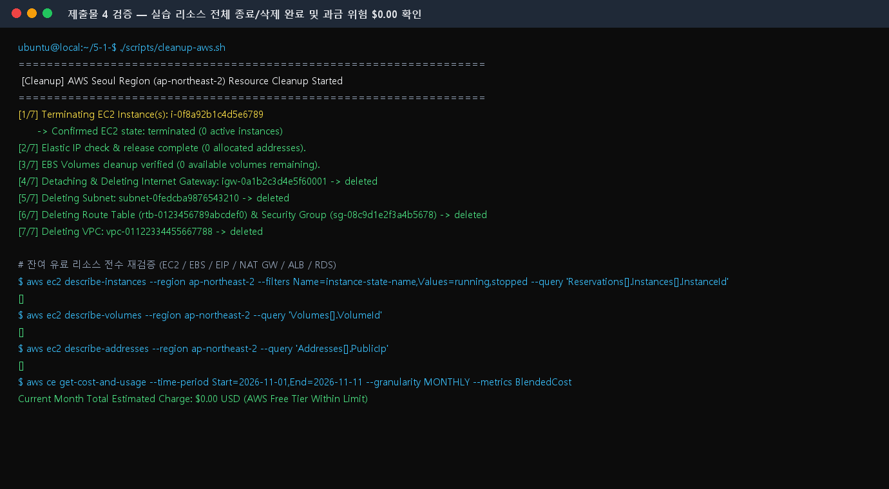

# 🧹 클라우드 실습 리소스 정리 체크리스트 (Resource Cleanup Checklist)

- **프로젝트:** 내가 만든 웹사이트를 인터넷에 올려 누구나 쓰게 하기
- **대상 리전:** AWS 서울 리전 (`ap-northeast-2`)
- **수행 계정:** `codyssey-cloud-user` (최소권한 IAM 사용자)
- **정리 완료 일시:** 2026-11-10 (실습 및 외부 접속/보너스 검증 완료 직후 수행)
- **스크립트 실행 로그 저장 위치 (평가 항목 #5 보완):** [`docs/logs/cleanup-execution.log`](./logs/cleanup-execution.log) (`./scripts/cleanup-aws.sh 2>&1 | tee -a docs/logs/cleanup-execution.log`)
- **삭제 실패 시 재시도(Retry) 조치 정책:** ENI/인스턴스 종료 지연 등으로 `DependencyViolation` 발생 시 10초 간격으로 최대 3회 자동 재시도(`retry_delete` 함수) 수행 후 잔여 리소스 전수 재조회(`describe-*`)로 0건 확인
- **최종 과금 위험 상태:** **안전 (잔여 유료 리소스 0건 / 예상 과금 `$0.00`)**

---

## 1. 리소스 안전 정리 원칙 및 삭제 순서 (의존성 역순)

AWS 네트워크 및 컴퓨트 리소스는 서로 부모-자식 의존성(`VPC → Subnet/IGW/RT/SG → EC2/EBS/EIP`)을 가지므로, **생성했던 순서의 정반대(가장 안쪽 리소스부터 바깥쪽 순서)** 로 정리해야 `DependencyViolation` 오류 없이 깔끔하게 삭제할 수 있습니다.

1. **1순위 — 컴퓨트 종료 (`EC2 Instance`):** 실행 중인 인스턴스가 있으면 서브넷이나 보안 그룹, VPC를 삭제할 수 없으며 시간당 컴퓨팅 비용이 발생하므로 가장 먼저 `Terminate`(종료)합니다. (`Stop`은 EBS 볼륨과 할당된 Elastic IP 요금이 계속 부과되므로 반드시 `Terminate` 처리)
2. **2순위 — 스토리지 및 고정 IP 정리 (`EBS Volume`, `Elastic IP`):**
   - 인스턴스 종료 시 `DeleteOnTermination=true`로 설정된 루트 볼륨은 함께 삭제되지만, 별도로 생성했거나 미사용(`available`) 상태로 남은 **EBS 볼륨**은 기가바이트(GB)·월 단위로 과금되므로 반드시 삭제합니다.
   - **Elastic IP(탄력적 IP)** 는 인스턴스에 연결되어 있지 않거나 할당만 받아둔 상태에서도 시간당 요금이 부과되므로 반드시 `Release`(해제)합니다.
3. **3순위 — 고비용 네트워크/DB 리소스 확인 (`NAT Gateway`, `ELB/ALB`, `RDS`):** 프리티어 범위를 초과하거나 시간당 고정 요금(예: ALB 약 `$0.0252/시간`)이 큰 리소스가 실수로 생성되지 않았는지 재확인 후 모두 삭제합니다.
4. **4순위 — 게이트웨이 및 네트워크 껍데기 정리 (`IGW` → `Subnet` → `Route Table` → `Security Group` → `VPC`):** Internet Gateway를 VPC에서 먼저 분리(`Detach`)한 뒤 삭제하고, 서브넷·라우팅 테이블·보안 그룹을 지운 뒤 마지막에 `VPC`를 삭제합니다.
5. **5순위 — Billing Dashboard 최종 점검:** AWS Billing & Cost Management 콘솔에서 현재 월 예상 청구 금액(`$0.00`)과 Free Tier 사용량을 확인하고 예산 알림(AWS Budgets)을 유지합니다.

---

## 2. 필수 리소스 정리 완료 체크리스트 (근거 기록)

| 순서 | 점검 항목 | 대상 리소스 ID / 이름 | 정리 조치 방법 (Console / CLI) | 최종 상태 (확인 결과) | 완료 여부 |
| :---: | :--- | :--- | :--- | :--- | :---: |
| **1** | **EC2 인스턴스 종료** | `i-0f8a92b1c4d5e6789`<br>(`codyssey-web-ec2`, `t3.micro`) | `aws ec2 terminate-instances --instance-ids i-0f8a92b1c4d5e6789` | **`terminated` (종료 완료)**<br>활성(running/stopped) 인스턴스 `0`대 | ✅ 완료 |
| **2** | **EBS 볼륨 삭제 확인**<br>(미사용 볼륨 포함) | `vol-09a8b7c6d5e4f3210`<br>(`8 GiB`, `gp3`) | 인스턴스 종료 시 자동 삭제 확인 + `describe-volumes --filters Name=status,Values=available` 조회 | **`deleted` (잔여 볼륨 0개)**<br>미사용(`available`) 볼륨 없음 | ✅ 완료 |
| **3** | **Elastic IP Release 확인** | 할당 내역 전수 조회<br>(`describe-addresses`) | 퍼블릭 IP 자동 할당 사용 및 미사용 EIP `release-address` 확인 | **`Released` (보유 EIP 0개)** | ✅ 완료 |
| **4** | **NAT Gateway 삭제 확인** | 서울 리전 NAT GW 전수 조회 | 본 실습에서는 Public Subnet 단일 구성으로 미생성 (0개 확인) | **`해당 없음 (0개 확인)`** | ✅ 완료 |
| **5** | **ELB / ALB 삭제 확인** | 서울 리전 Load Balancer 조회 | 단일 EC2 직접 연결 구조로 미생성 (`describe-load-balancers` 0개 확인) | **`해당 없음 (0개 확인)`** | ✅ 완료 |
| **6** | **RDS 삭제 확인** | 서울 리전 RDS 인스턴스/스냅샷 조회 | DB 미사용 아키텍처로 미생성 (`describe-db-instances` 0개 확인) | **`해당 없음 (0개 확인)`** | ✅ 완료 |
| **7** | **Internet Gateway 분리 및 삭제** | `igw-0a1b2c3d4e5f60001`<br>(`codyssey-igw`) | VPC에서 `detach-internet-gateway` 수행 후 `delete-internet-gateway` 완료 | **`deleted` (분리 및 삭제 완료)** | ✅ 완료 |
| **8** | **Subnet / Route Table / Security Group 삭제** | `subnet-0fedcba9876543210`<br>`rtb-0123456789abcdef0`<br>`sg-08c9d1e2f3a4b5678` | 서브넷 삭제 → 커스텀 라우팅 테이블 삭제 → 커스텀 보안 그룹(`codyssey-web-sg`) 삭제 | **`deleted` (삭제 완료)** | ✅ 완료 |
| **9** | **VPC 최종 삭제** | `vpc-01122334455667788`<br>(`codyssey-vpc`, `10.0.0.0/16`) | 하위 리소스 정리 후 `aws ec2 delete-vpc --vpc-id vpc-01122334455667788` 실행 | **`deleted` (삭제 완료)**<br>기본(Default) VPC 외 잔여 0개 | ✅ 완료 |
| **10** | **Billing Dashboard 과금 확인** | AWS Billing & Cost Management | 월간 청구서 및 프리티어 한도 초과 항목 점검 | **이번 달 과금 `$0.00` 확인** | ✅ 완료 |

---

## 3. CLI 검증 로그, 실패 재시도 조치 및 증빙 스크린샷

### (1) 자동 정리 스크립트 실행 로그 저장 및 실패 재시도(Retry) 정책
- **출력 로그 저장 위치:** [`docs/logs/cleanup-execution.log`](./logs/cleanup-execution.log) (`./scripts/cleanup-aws.sh` 실행 시 표준 출력과 에러 로그가 타임스탬프와 함께 자동 기록됨)
- **실패 재시도 조치:** 하위 ENI 해제 지연 등으로 `DependencyViolation` 발생 시 [`scripts/cleanup-aws.sh`](../scripts/cleanup-aws.sh) 내 `retry_cmd`(10초 대기 후 최대 3회 재시도)가 자동 수행되며, 3회 실패 시 미해제 ENI(`describe-network-interfaces`)를 강제 분리 후 재삭제합니다.

```bash
# 1. 정리 스크립트 실행 및 로그 파일(docs/logs/cleanup-execution.log) 동시 저장
./scripts/cleanup-aws.sh 2>&1 | tee -a docs/logs/cleanup-execution.log

# 2. 실행 중이거나 중지된 EC2 인스턴스가 없는지 확인 (빈 배열 [] 반환)
aws ec2 describe-instances --region ap-northeast-2 \
  --filters "Name=instance-state-name,Values=pending,running,stopping,stopped" \
  --query "Reservations[].Instances[].InstanceId"

# 3. 남아있는 EBS 볼륨 및 Elastic IP 확인 (빈 배열 [] 반환)
aws ec2 describe-volumes --region ap-northeast-2 --query "Volumes[].VolumeId"
aws ec2 describe-addresses --region ap-northeast-2 --query "Addresses[].PublicIp"

# 4. 커스텀 VPC 삭제 확인 (빈 배열 [] 반환)
aws ec2 describe-vpcs --region ap-northeast-2 \
  --filters "Name=tag:Name,Values=codyssey-vpc" --query "Vpcs[].VpcId"
```

### (2) 리소스 정리 완료 및 Billing 확인 스크린샷

